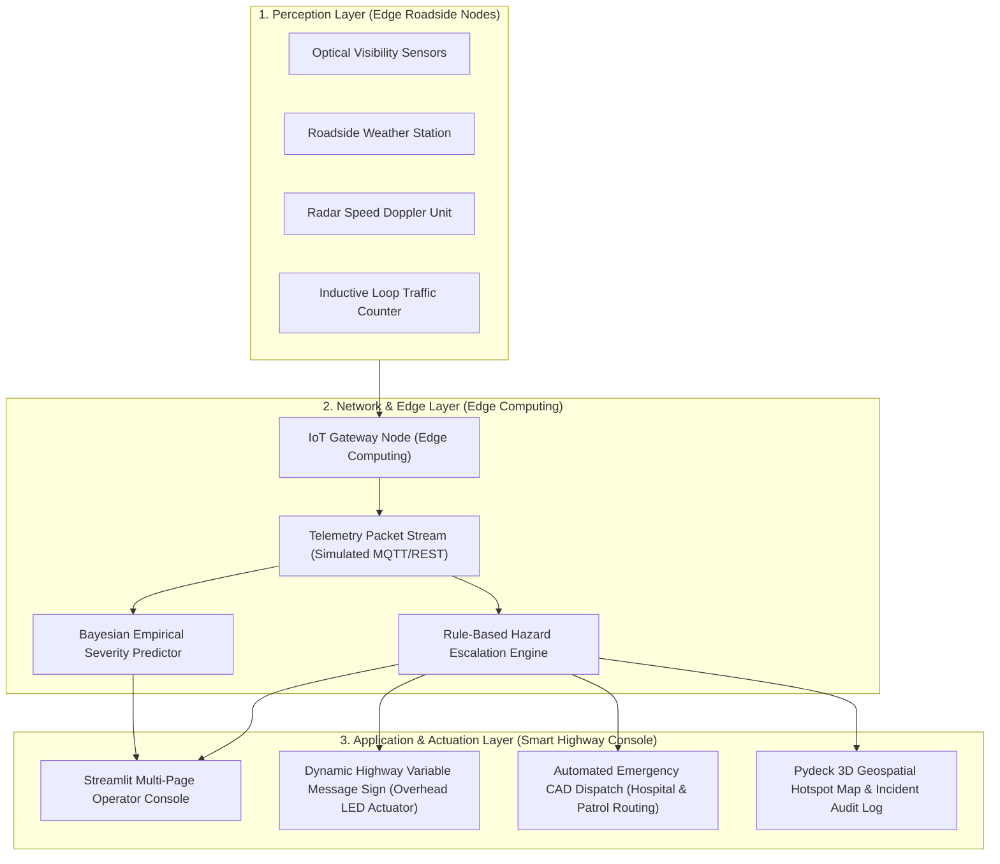

# 🚗 Road Accident Pattern Analysis & IIoT Smart Highway Monitoring

[](https://road-accident-pattern-analysis.streamlit.app/)


> **Course Project:** Industrial Internet of Things (IIoT-3)  
> **Team Leader:** Lovish Chauhan (`lovishneeraj@gmail.com`)  
> **Team Size:** 14 Members  
> **🌐 Live Deployment Link:** [https://road-accident-pattern-analysis.streamlit.app/](https://road-accident-pattern-analysis.streamlit.app/)  
> **GitHub Repository:** [https://github.com/igris-bit/Road-Accident-Pattern-Analysis](https://github.com/igris-bit/Road-Accident-Pattern-Analysis)  

---

## 📌 Project Overview

Road traffic collisions cause over 150,000 fatalities annually across India. Traditional transportation safety systems are fundamentally retrospective—relying on post-accident police records that cannot prevent collisions before they occur.

This project delivers a **hybrid intelligent safety framework** that combines **empirical pattern recognition** on 20,000 real Indian road accident records with **Industrial IoT (IIoT) edge simulation and closed-loop actuation**:

1. **Descriptive & Predictive Analytics Dashboard:** Interactive data filtering, casualty risk mapping, and an empirical Bayesian **"What-If" Accident Severity Predictor**.
2. **IIoT Smart Highway Edge & Actuator Monitor:** Real-time roadside telemetry generation, dynamic overhead **Variable Message Sign (VMS)** speed limit overrides, and **Computer-Aided Dispatch (CAD)** routing to regional Level-1 trauma centers within the critical *Golden Hour*.

---

## 🏗️ 3-Tier Industrial IoT Architecture



---

## 🚀 Key Modules & System Features

### Module 1 — Historical Pattern Analytics & "What-If" Severity Predictor (`streamlit_app.py`)
* **Multivariate Filtering:** Instant drill-down across State, City, Severity, Road Type, and Weather.
* **Core KPI Metrics:** Real-time metrics for Total Accidents, Total Casualties, Fatal % Ratio, and Average Corridor Risk Index.
* **2×2 Analytical Matrix:** Hourly commuting patterns (24h format), weather distributions, severity breakdowns, and road classification profiles.
* **State-Wise Breakdown:** Comparative bar charts ranking the Top 10 Indian states by accident volume and casualty toll.
* **🧠 What-If AI Severity Predictor:** 
  - Simulates custom driving conditions (City, Road Type, Weather, Visibility, Traffic Density, Hour, Vehicles Involved).
  - Calculates empirical probability distributions: **Minor %**, **Major %**, and **Fatal %**.
  - Computes a normalized composite risk index `[0.00, 1.00]` and flags contributing hazard factors.

### Module 2 — IIoT Edge Telemetry & Smart Actuation (`pages/iot_monitor.py`)
* **Live Roadside Telemetry:** Simulates real-time sensor packets (temperature, optical visibility, precipitation, vehicular speed, and traffic density).
* **Multi-Tier Hazard Engine:** Escalates danger levels across `SAFE` &rarr; `LOW` &rarr; `MEDIUM` &rarr; `HIGH`.
* **💡 Smart Highway Variable Message Sign (VMS):** 
  - Closed-loop physical actuation: renders an electronic overhead LED matrix billboard with retro-illuminated amber/red typography.
  - Dynamically overrides highway speed limits: **80 km/h** *(Clear)* &rarr; **50 km/h** *(Rain)* &rarr; **35 km/h** *(Dense Fog / Night Collision Hazard)*.
* **🚑 Automated Emergency Services CAD Dispatch:** 
  - Automatically identifies and alerts regional Level-1 trauma care hospitals (*AIIMS Delhi, KEM Mumbai, Victoria Hospital Bangalore, PGIMER Chandigarh, etc.*).
  - Assigns highway patrol interceptors and calculates real-time ambulance arrival ETAs (5–8 minutes).
* **🗺️ Geospatial Hotspot Map:** Interactive Pydeck 3D Scatterplot mapping historical accident blackspots alongside the active live sensor node.
* **📜 Incident Audit Log:** Session-based incident log with one-click timestamped CSV export for municipal safety audits.

---

## 📊 Dataset Specification

The project is empirically grounded in `indian_roads_dataset.csv`, consisting of **20,000 real records** spanning 24 attributes across 8 metropolitan corridors:

| Corridor City | Primary Highway Belt | Designated Level-1 Trauma Hospital | Assigned Highway Patrol |
| :--- | :--- | :--- | :--- |
| **Bangalore** | Central Corridor / Hosur Rd / ORR | Victoria Hospital Trauma Care Centre | Traffic Command Unit 04 |
| **Chandigarh** | Madhya Marg - Tribune Chowk Corridor | PGIMER Level-1 Apex Trauma Centre | Highway Patrol PCR-12 |
| **Chennai** | Anna Salai - Guindy Arterial Belt | Rajiv Gandhi Govt General Hospital | Greater Chennai Traffic Police Unit 08 |
| **Delhi** | Ring Road - DND Expressway Zone | AIIMS Apex Trauma Centre | Delhi Traffic Police Interceptor 02 |
| **Hyderabad** | Outer Ring Road (ORR) Gachibowli | Osmania General Hospital Trauma Wing | Cyberabad Patrol Unit 09 |
| **Kolkata** | EM Bypass - Park Circus Connector | SSKM Hospital Trauma Care Facility | Kolkata Traffic Police Lalbazar PCR |
| **Mumbai** | WEH - Bandra Reclamation Expressway | KEM Hospital Emergency & Trauma Care | Western Express Patrol Unit |
| **Pune** | Mumbai-Pune Bypass (Warje-Katraj) | Sassoon General Hospital Trauma Centre | Pune City Traffic Branch Unit 05 |

---

## 🗂️ Project Organization & File Structure

```
Road-Accident-Pattern-Analysis/
│
├── .vscode/                               # Workspace configuration
│   └── settings.json                      # Python 3.12 interpreter path
│
├── docs/                                  # 📋 Official Submission Materials & Reports
│   ├── SUBMISSION_DETAILS.md              # All 4 mandatory submission links & checklist
│   ├── TEAM_CONTRIBUTIONS.md              # Honest 14-member contribution & evaluation matrix
│   ├── PROJECT_REPORT.md                  # Comprehensive IEEE-style academic project report
│   ├── report/                            # Compiled PDF Documentation
│   │   └── Road_Accident_Pattern_Analysis_Project_Report.pdf # Publication-ready PDF Report
│   └── presentation/                      # Presentation Materials
│       ├── Road_Accident_Pattern_Analysis_Presentation.pptx  # 15-Slide Professional PPTX
│       └── PROJECT_PPT_OUTLINE.md         # Slide-by-slide outline & speaker notes
│
├── notebooks/                             # Research & Exploratory Data Analysis
│   └── Road_Accident_Pattern_Analysis.ipynb # Colab / Jupyter research notebook
│
├── pages/                                 # Multi-Page Navigation
│   └── iot_monitor.py                     # Module 2: IIoT Telemetry, VMS & CAD Dispatch
│
├── indian_roads_dataset.csv               # Ground-truth dataset (20,000 records × 24 features)
├── iot_simulator.py                       # IIoT simulation & predictive severity engine
├── streamlit_app.py                       # Module 1: Main Dashboard entry point (Streamlit Cloud)
├── requirements.txt                       # Python dependencies
├── packages.txt                           # System-level dependencies
├── run_app.bat                            # One-click Windows application launcher
└── README.md                              # Complete repository documentation
```

---

## ⚙️ Quickstart & Execution Guide

### Option 1: One-Click Windows Launch (Recommended)
Simply double-click the included batch runner in File Explorer:
```
run_app.bat
```
*It automatically detects your Python 3.12 environment, bypasses PowerShell execution restrictions, and opens the dashboard in your default browser!*

### Option 2: Manual Terminal Launch
```bash
# 1. Clone repository
git clone https://github.com/igris-bit/Road-Accident-Pattern-Analysis.git
cd Road-Accident-Pattern-Analysis

# 2. Install dependencies
pip install -r requirements.txt

# 3. Launch application
python -m streamlit run streamlit_app.py
```

Navigate to **IoT Monitor** in the sidebar to access Module 2 (IIoT Simulation & Actuation).

---

## 👥 14-Member Team Contributions by Branch

| # | Member Name | Branch / Commit | Role & Technical Contributions Delivered | Contribution |
| :-: | :--- | :--- | :--- | :-: |
| **1** | **Lovish Chauhan** *(Lead)* | `Lovish` | **Team Leader & Architect:** Live Streamlit Cloud CI/CD deployment; built What-If Severity Predictor, Smart VMS LED Actuator, and CAD Dispatch Simulator; refactored production on `streamlit_app.py`; built `run_app.bat`. | **High (Lead)** |
| **2** | **Krishu Kumar** | `krishu` | **Foundational Dashboard & Colab:** Created initial Streamlit app (`fca04dc`, `fd8d996`), integrated 20,000 records, authored Colab research notebook (`98f279f`), configured `packages.txt`. | **High** |
| **3** | **Mayank Gupta** | `mayank` | **IoT Simulation Engine:** Created initial `iot_simulator.py` and `pages/iot_monitor.py` (`269d0c1`), integrated Pydeck and Numpy requirements, managed patch synchronization (`2f38c7e`). | **High** |
| **4** | **Alok Chaubey** | `alok` | **Engineering & Sync:** Fixed IoT syntax errors and deduplicated sensor methods (`5f14dde`), synchronized state variables in `streamlit_app.py`, created Dev Container environment (`e5dfaf4`). | **High** |
| **5** | **Arvind Mourya** | `arvind` | **State Analytics:** Built State-Wise Accident Analysis dashboard (`567d35e`), implemented state aggregations for accidents and casualties with dual bar charts. | **High** |
| **6** | **Amit Kohli** | `c8f4245` | **Safety Insights Banner:** Engineered threshold alerts for High/Moderate risk conditions (`c8f4245`) and adverse weather frequency counters. | **High** |
| **7** | **Ayush Patel** | `ayush` | **Data Verification & Setup:** Managed PR #4 integration (`c108d2c`), synchronized `streamlit_app.py` updates (`396683d`), contributed setup documentation (`2c3227a`). | **High** |
| **8** | **Pritam Kumar** *(Athox-X)* | `pritam` | **UI & Telemetry Enhancement:** Refined `iot_simulator.py` sensor generation (`0aa5a8d`) and alert display styling in `pages/iot_monitor.py` (`03be2bc`). | **Medium** |
| **9** | **Kritika** | `kritikaaa` | **Team Guidelines:** Authored `CONTRIBUTING.md` setup instructions (`17c34b4`), verified simulation parameters and supported documentation. | **Medium** |
| **10** | **Sunal** | `sunal` | **Documentation Iterations:** Updated `iot_monitor.py` parameters (`b54a36b`), authored multiple `README.md` documentation revisions (`f81277d`, `82a8fdd`, `fff9bae`). | **Medium** |
| **11** | **Daniyal Malik** | `Daniyal` | **Notebook & Schema Audit:** Standardized notebook naming to `Road_Accident_Pattern_Analysis.ipynb` (`3758353`) and verified dataset column schemas. | **Medium** |
| **12** | **Riddhi Gupta** | `Riddhi-Gupta` | **Research & Overview:** Documented project feature overviews in `README.md` (`91db893`, `bad32ef`), researched Indian metropolitan collision patterns. | **Medium** |
| **13** | **Ayan Ansari** | `ayan` | **Inactive Member:** Assigned to deployment verification but did not actively contribute functional code or project deliverables. | **Inactive** |
| **14** | **Om** | `om` | **Inactive Member:** Assigned to QA review but made zero functional code commits or technical deliverables to the repository. | **Inactive** |

---

## 📋 Official Submission Deliverables

| Deliverable | Format / Link | Location in Repository |
| :--- | :--- | :--- |
| **1. GitHub Repository** | Public Git Repository | [https://github.com/igris-bit/Road-Accident-Pattern-Analysis](https://github.com/igris-bit/Road-Accident-Pattern-Analysis) |
| **2. Project PPT** | PowerPoint Presentation | [`docs/presentation/Road_Accident_Pattern_Analysis_Presentation.pptx`](docs/presentation/Road_Accident_Pattern_Analysis_Presentation.pptx) |
| **3. Project Report** | Academic PDF Report | [`docs/report/Road_Accident_Pattern_Analysis_Project_Report.pdf`](docs/report/Road_Accident_Pattern_Analysis_Project_Report.pdf) |
| **4. Live Deployment** | Web Application | [https://road-accident-pattern-analysis.streamlit.app/](https://road-accident-pattern-analysis.streamlit.app/) |
| **5. Team Audit Matrix** | Markdown Document | [`docs/TEAM_CONTRIBUTIONS.md`](docs/TEAM_CONTRIBUTIONS.md) |
| **6. Submission Details** | Form Template | [`docs/SUBMISSION_DETAILS.md`](docs/SUBMISSION_DETAILS.md) |

---

## 📜 License

This project is licensed under the **MIT License** — open for academic, educational, and transportation safety research.
